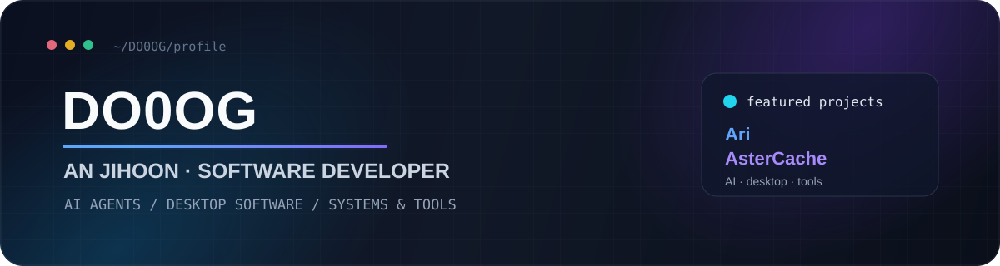

[English](./README.md) · **한국어**

 

**실제로 사용할 수 있는 데스크톱 애플리케이션과 AI 비서, 개발 도구를 만들고 검증합니다.**

C# / .NET · Python · Avalonia · PySide6 · Windows 및 크로스플랫폼 개발

[최근 프로젝트](#최근-프로젝트) · [다른 프로젝트](#다른-프로젝트) · [기술 스택](#기술-스택) · [이력](#이력)

---

## 최근 프로젝트

최근에 개발하거나 업데이트한 공개 프로젝트입니다. Windows 유틸리티, AI 응용 프로그램, 개발 도구를 중심으로 소개합니다.

### [AsterCache — HDD 게임 로딩 최적화](https://github.com/DO0OG/AsterCache)

**게임 전체를 SSD로 옮기지 않고, HDD에 설치된 게임을 반복 실행할 때 발생하는 디스크 탐색 부담을 줄이기 위해 개발 중인 Windows 11용 실험적 유틸리티입니다.**

`C#` `.NET 10` `Windows` `NTFS` `ETW` `RAM Cache`

- Windows 이벤트 추적(ETW)을 이용해 게임 실행 중 파일을 읽는 순서와 위치를 기록합니다.
- NTFS 데이터 재배치, 접근 순서 기반 미리 읽기(prefetch), RAM 프리워밍을 통해 이후 실행에서 데이터 접근 효율을 높이도록 설계했습니다.
- 게임 자동 탐지, 백그라운드 동작, 안전장치와 [공유 읽기 순서 프로필](https://github.com/DO0OG/AsterCache-profiles)을 지원합니다.

실험 단계의 성능 개선 프로젝트입니다. 기록된 디스크 읽기 패턴을 재생한 측정값만으로 실제 게임의 로딩 시간 단축이 입증되는 것은 아닙니다. 데이터 재배치 과정에서 HDD에 쓰기가 발생하므로, 중요한 데이터는 백업하고 호환성 및 주의사항을 먼저 확인해야 합니다.

 

### [Ari — AI 음성 비서 및 자율 데스크톱 에이전트](https://github.com/DO0OG/Ari-VoiceCommand)

**음성 상호작용, 로컬·원격 언어 모델, Windows 자동화와 도구 기반 작업 처리를 결합한 오픈소스 Windows 음성 비서입니다.**

`Python` `PySide6` `Ollama` `MCP` `STT/TTS` `AI Agent`

- 호출어 인식, 다국어 음성 인식과 음성 응답, 상호작용 가능한 데스크톱 캐릭터를 제공합니다.
- 로컬 LLM, 기억 기능, 플러그인, `SKILL.md` 스킬, Model Context Protocol(MCP) 연동을 지원합니다.
- 도구를 활용한 데스크톱 작업을 계획·실행·검증하고 진행 중인 작업을 중단할 수 있습니다.

[프로젝트 홈페이지](https://ari-voice-command.vercel.app) · [최신 릴리스 다운로드](https://github.com/DO0OG/Ari-VoiceCommand/releases/latest) · [사용 및 설치 안내](https://github.com/DO0OG/Ari-VoiceCommand#install)

 

### [agk75-tool — AGK75 키보드 비공식 설정 도구](https://github.com/DO0OG/agk75-tool)

**Antgamer AGK75의 USB HID 통신 프로토콜을 분석해 개발한 비공식 데스크톱 설정 프로그램입니다.**

`Python` `PySide6` `HID API` `Device Configuration`

- 키 재배치, Fn 레이어, 프로필, 조명, 래피드 트리거 및 폴링레이트 설정을 지원합니다.
- 기기에서 설정값을 다시 읽어 적용 여부를 확인하며, 설정 백업·복원과 USB 폴링레이트 측정 기능을 제공합니다.
- 한국어·영어·중국어 간체 UI를 제공하며, 프로그램 사용에 네트워크 연결이 필요하지 않습니다.

Antgamer와 제휴하지 않은 비공식 프로젝트입니다. USB로 연결한 호환 AGK75 기기를 대상으로 합니다.

---

## 다른 프로젝트

### [CustomLauncher — 크로스플랫폼 Minecraft 런처](https://github.com/DO0OG/CustomLaucncher)

`C#`, `.NET 8`, `Avalonia`로 개발한 **Windows·macOS·Linux용 Minecraft 서버 런처 및 콘텐츠 배포 클라이언트**입니다.

- Microsoft/Xbox 계정 로그인 및 계정 관리
- 무결성을 검사하는 변경 파일 다운로드, 복구, 롤백, 모드·리소스팩 관리
- 다중 서버 설정, Forge/Fabric/NeoForge/Quilt 지원, 업데이트 기능

 

### [yttStudio — YouTube 자막 시각 편집기](https://github.com/DO0OG/yttStudio)

`C#`, `.NET 10`, `Avalonia` 기반의 크로스플랫폼 **YTT/SRV3 자막 WYSIWYG 편집기**입니다.

- 영상 미리보기 화면에서 자막의 위치와 스타일을 직접 편집
- 타임라인, 가라오케 타이밍, 다중 키프레임 애니메이션과 효과 지원
- YouTube 자막 포맷의 제약 조건 검사 및 스타일 자막 내보내기

---

## 기술 스택

**프로그래밍 언어**

**데스크톱 및 인터랙티브 개발**

**개발 도구 및 시스템**

## 관심 및 개발 분야

- **AI 비서와 에이전트 작업 흐름:** 음성 인터페이스, 로컬 모델, 도구 연동, 데스크톱 자동화
- **데스크톱 애플리케이션 개발:** 네이티브 UI, 크로스플랫폼 프로그램, 유지보수하기 쉬운 구조
- **성능 및 시스템:** 병목 측정, 디스크 I/O 개선, 효율적인 처리 방식 연구
- **소프트웨어 배포 및 품질:** 자동화 테스트, CI/CD, 설치 프로그램, 릴리스·업데이트·복구 흐름

---

## 이력

**서원대학교** · 컴퓨터공학 전공  
**대한상공회의소** · Unity 부트캠프

---

## GitHub 활동

---

실용적인 소프트웨어를 만들고, 검증하고, 꾸준히 개선합니다.

