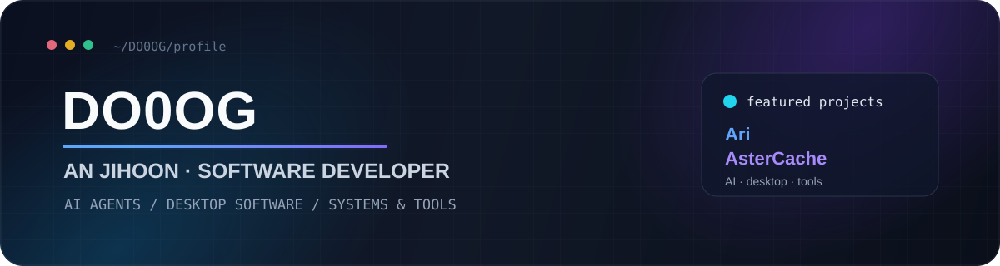

**English** · [한국어](./README.ko.md)

 

**I build desktop applications, AI assistants, and developer tools, with a focus on practical use and careful validation.**

C# / .NET · Python · Avalonia · PySide6 · Windows & cross-platform development

[Recent projects](#recent-projects) · [More projects](#more-projects) · [Tech stack](#tech-stack) · [Background](#background)

---

## Recent Projects

Recent public work, with a focus on Windows utilities, AI, and developer tooling.

### [AsterCache — HDD Game Loading Optimization](https://github.com/DO0OG/AsterCache)

**An experimental Windows 11 utility designed to reduce HDD seek overhead during repeated game loads without moving entire games to an SSD.**

`C#` `.NET 10` `Windows` `NTFS` `ETW` `RAM Cache`

- Records game file-read patterns using Windows Event Tracing (ETW).
- Uses NTFS data relocation, access-order prefetching, and RAM prewarming to improve data locality on subsequent launches.
- Includes background game discovery, automatic operation, safety checks, and [shared load-order profiles](https://github.com/DO0OG/AsterCache-profiles).

Experimental: recorded I/O replay results are not proof of faster real-game loading. Data relocation writes to the HDD; read the compatibility notes and back up important data first.

 

### [Ari — AI Voice Assistant & Autonomous Desktop Agent](https://github.com/DO0OG/Ari-VoiceCommand)

**An open-source Windows voice assistant and desktop agent combining speech interaction, local or hosted language models, Windows automation, and tool-based workflows.**

`Python` `PySide6` `Ollama` `MCP` `STT/TTS` `AI Agent`

- Wake-word activation, multilingual speech recognition, spoken replies, and an interactive desktop character.
- Local LLM support, memory, plugins, `SKILL.md` skills, and Model Context Protocol (MCP) integrations.
- Tool-driven desktop tasks with planning, execution, verification, and interruption controls.

[Project homepage](https://ari-voice-command.vercel.app) · [Download latest release](https://github.com/DO0OG/Ari-VoiceCommand/releases/latest) · [Documentation](https://github.com/DO0OG/Ari-VoiceCommand#install)

 

### [agk75-tool — Unofficial AGK75 Keyboard Configuration](https://github.com/DO0OG/agk75-tool)

**An unofficial desktop configuration utility for the Antgamer AGK75, developed by examining the keyboard's USB HID protocol.**

`Python` `PySide6` `HID API` `Device Configuration`

- Key remapping, Fn layers, profiles, lighting effects, rapid-trigger controls, and polling-rate configuration.
- Device read-back verification, settings backup/restore, and USB polling-rate diagnostics.
- Korean, English, and Simplified Chinese user interfaces; no network connection required for the app.

Unofficial project; not affiliated with Antgamer. Designed for a compatible AGK75 connected over USB.

---

## More Projects

### [CustomLauncher — Cross-platform Minecraft Launcher](https://github.com/DO0OG/CustomLaucncher)

A configurable Minecraft launcher and distribution client for **Windows, macOS, and Linux**, built with `C#`, `.NET 8`, and `Avalonia`.

- Microsoft/Xbox sign-in and account management.
- Integrity-checked incremental downloads, repair, rollback, and mod/resource-pack management.
- Multiple server configurations, Forge/Fabric/NeoForge/Quilt support, and update workflows.

 

### [yttStudio — Visual YouTube Subtitle Editor](https://github.com/DO0OG/yttStudio)

A cross-platform **WYSIWYG YTT/SRV3 subtitle editor** built with `C#`, `.NET 10`, and `Avalonia`.

- Edit subtitle placement and styling directly on a video preview.
- Work with timelines, karaoke timing, multi-keyframe animation, and subtitle effects.
- Validate YouTube subtitle-format constraints and export styled subtitles.

---

## Tech Stack

**Languages**

**Desktop & Interactive Development**

**Tooling & Systems**

## Current Interests

- **AI assistants and agent workflows:** speech interfaces, local models, tool integrations, and desktop automation.
- **Desktop application engineering:** responsive native UIs, cross-platform apps, and maintainable architectures.
- **Performance and systems:** measuring bottlenecks, improving disk I/O, and exploring efficient workflows.
- **Software delivery:** automated tests, CI/CD, installers, releases, updates, and recovery paths.

---

## Background

**Computer Engineering** · Seowon University  
**Unity Bootcamp** · Korea Chamber of Commerce and Industry

---

## GitHub Activity

---

Build useful things. Make them reliable. Keep improving them.

